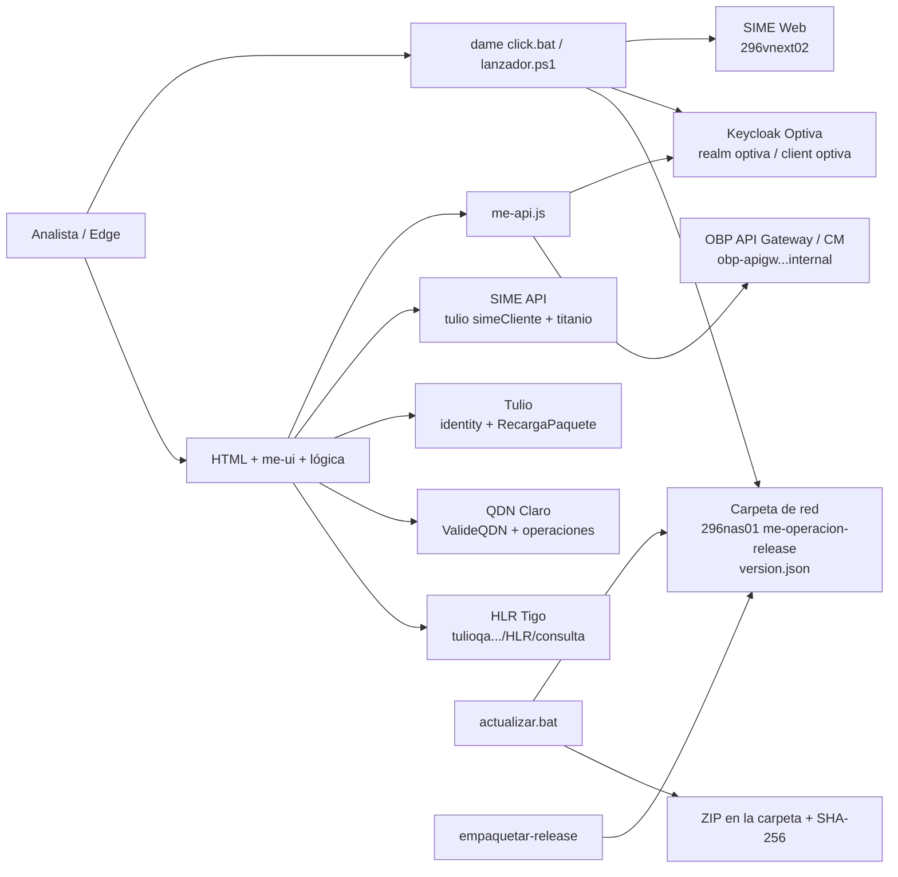

# Contexto de continuidad para Codex

> Última actualización: 2026-10-12 · Zona horaria del proyecto: America/Bogota.
>
> Leer este archivo antes de modificar la suite. La documentación funcional
> detallada vive en `doc/`; este archivo resume arquitectura, conexiones,
> decisiones y estado de publicación para retomar el trabajo sin redescubrirlo.

## 1. Qué es este proyecto

Suite local de herramientas operativas de **Móvil Éxito**. Se distribuye como
HTML/CSS/JavaScript estático y se abre mediante `dame click.bat`. No tiene
backend propio: el navegador consulta directamente servicios internos de SIME,
Optiva/CM, Tulio, QDN Claro y HLR Tigo.

- Entorno principal: Windows + Windows PowerShell 5.1 + Edge/Chromium.
- El lanzador abre Edge con la configuración necesaria para los servicios
  internos; no asumir que abrir un HTML con doble clic tendrá el mismo CORS.
- No hay build de Node ni dependencias instalables. Las librerías visuales se
  cargan desde CDN; sus versiones y URLs viven en `assets/base/dependencias.js`.
- El código está en Git (`github.com/sebasmd-projects/me-operacion`, rama
  `master`). **El repositorio es público**: ver §7 antes de subir cualquier
  cosa. La distribución a los analistas NO usa Git: va por ZIP + `version.json`
  (§5).

Documentos de entrada:

- `doc/GETTINGSTARTED.md`: uso y publicación.
- `doc/README.md`: catálogo y convenciones.
- `doc/lanzador/README.md`: base compartida, lanzador, actualización y empaquetado.
- `doc/<herramienta>/README.md`: reglas de negocio e historial de cada módulo.

## 2. Mapa de archivos

```text
index.html                         catálogo/inicio
dame click.bat                     wrapper del lanzador
actualizar.bat                     wrapper del actualizador manual
scripts/
  lanzador.ps1                     sesiones iniciales, Edge y aviso de versión
  actualizar.ps1                   descarga, SHA-256, extracción y aplicación
  empaquetar-release.ps1/.bat      crea ZIP + version.json (no se distribuye)
  VERSION                          versión global publicada
herramientas/*.html                marcado; evitar poner reglas de negocio aquí
assets/
  base/                            la base común (la usan todas las páginas)
    me-ui.js / me-ui.css             shell, pasos, tablas, exportación, copiar
    me-api.js                        Keycloak y acceso común al CM
    catalogo.js                      catálogo ÚNICO de herramientas (window.ME_CATALOGO):
                                     menú, tarjetas/Backlog de Inicio, título, versión, doc
    dependencias.js                  registro ÚNICO de librerías de CDN (data-me-deps)
  compartido/                      módulos que usan varias herramientas
    cm-lineas.js                     órdenes de línea del CM (window.CMLineas)
    hlr-consulta.js                  ubicación Claro + Tigo
    tulio-plu.js                     Tulio RecargaPaquete (window.TulioPLU)
    genesis-api.js / genesis-bookmarklet.js   sesión y marcador de Genesis
  herramientas/<id>/             código y estilos propios de cada herramienta
    <id>.js / <id>.css             configuración, reglas e interfaz; CSS fuera del HTML
    motores adicionales           cuando la herramienta usa varias pestañas o motores
doc/<modulo>/README.md             documentación e historial
release/                           artefactos que se suben al servidor
```

Regla arquitectónica: **HTML = marcado**, **herramienta = configuración, reglas e interfaz en `assets/herramientas/<id>/`**, **base = shell, acceso al CM y componentes visuales compartidos**, **compartido = servicios usados por varias herramientas**. Los scripts clásicos que conviven en una página usan IIFE y API global pequeña para evitar colisiones. Los estilos usados por dos o más herramientas viven en «Componentes compartidos» de `assets/base/me-ui.css`; las diferencias visuales conservadas usan `data-me-herramienta` en el body, con `:where` para mantener la especificidad. Lo exclusivo queda en el CSS de la herramienta.

## 3. Herramientas principales

| App (`id`) | Entrada | Lógica principal | Propósito | ¿Escribe? |
|---|---|---|---|---|
| Inicio | `index.html` | `assets/herramientas/inicio/inicio.js` | Catálogo y descarga de herramientas. | No |
| Prepagadas (`prepagadas`) | `reporte_prepagadas.html` | `assets/herramientas/prepagadas/prepagadas.js` | Cruce SIME ⇄ CM; alta de suscripción y edición de recurrencias en SIME. | Sí, SIME |
| Consumos (`consumos`) | `reporte_consumos.html` | `assets/herramientas/consumos/consumos.js` + `assets/herramientas/consumos/paquetes.js` | Línea, titular, paquetes, movimientos y CDR; **carga de paquetes** en el CM. | Sí, CM |
| Ajustes/Paquetes (`ajustes`) | `export_ajustes.html` | `assets/herramientas/ajustes/ajustes.js` | Ajustes de dinero y paquetes del CM. | No |
| Titularidad (`titularidad`) | `titularidad.html` | `assets/herramientas/titularidad/titularidad.js` | Log de titularidad de **Genesis** cruzado con CM y HLR/HSS. Única que habla con Genesis. | No |
| Tipificación (`tipificacion`) | `export_tipificacion.html` | `assets/herramientas/tipificacion/tipificacion.js` | Exportación de casos. | No |
| Casos masivos (`casos`) | `reporte_casos_masivos.html` | `assets/herramientas/casos/casos.js` | Cierre/anotación masiva (con simulación). | Sí, CM |
| Rechazos (`rechazo`) | `generar_rechazo.html` | `assets/herramientas/rechazo/rechazo.js` | PDF de rechazo de portabilidad. | No |
| Aplicar PLU (`plu`) | `aplicar_plu.html` | `assets/herramientas/plu/plu.js` + `tulio-plu.js` | PLU en Tulio (`RecargaPaquete`) + verificación y borrado de bolsillos en el CM. | Sí, Tulio + CM |
| Bloquear/Inactivar líneas (`estado-lineas`) | `estado_lineas.html` | `assets/herramientas/estado-lineas/estado-lineas.js` + `cm-lineas.js` | Bloquear/inactivar líneas en masivo. | Sí, CM |
| Cambio IMSI y línea Claro\|Tigo (`cambio-imsi-linea`) | `cambio_imsi_linea.html` | `assets/herramientas/cambio-imsi-linea/imsi.js` + `assets/herramientas/cambio-imsi-linea/msisdn.js` (un motor por pestaña) + `assets/herramientas/cambio-imsi-linea/cambio-imsi-linea.js` + `cm-lineas.js` | Dos pestañas con una sola sesión del CM. Cambio IMSI: SIM en masivo (`línea;imsi_nueva`). Cambio de línea (MSISDN): número en masivo (`línea;línea_nueva`, texto o Excel), orden de portabilidad `PortInExistingSubscription`, queda pendiente. | Sí, CM |
| Pre-factura (`prefactura`) | `prefactura.html` | `assets/herramientas/prefactura/calculo.js` (`window.Prefactura`) | Pre-factura del Plan Corporativo desde su Excel: corte, impuestos, resumen y archivo por filial. Local. | No |
| HLR/HSS (`hlr-hss`) | `hlr_hss.html` | `assets/herramientas/hlr-hss/` (`claro.js`, `tigo.js`, `ambos.js`, `hlr-hss.js`) | Consulta por operador y cruce; pestaña Claro opera la línea. | Sí, red Claro |
| Portabilidad Tigo (`portabilidad-tigo`) | `validador_portabilidad_tigo.html` | `assets/herramientas/portabilidad-tigo/portabilidad-tigo.js` | HLR Tigo con marco de portabilidad. | No |
| Audio a MP3 (`audio-mp3`) | `convertir_audio_mp3.html` | `assets/herramientas/audio-mp3/audio-mp3.js` | Conversión local a `mp3-*.mp3`. | No |

Validador QDN, QDN Tigo y Validador HLR cruzado se eliminaron junto con su código independiente por decisión del usuario: HLR/HSS las reemplaza. Su documentación técnica está integrada en `doc/hlr-hss/README.md`. La pestaña Ambos y `assets/compartido/hlr-consulta.js` aún mantienen reglas equivalentes de ubicación; hay que revisar ambos al cambiar esas reglas.

### Operaciones restringidas por usuario

Solo queda una lista de usuarios, en HLR/HSS Claro (guarda de interfaz, no
control de acceso):

| Constante | Archivo | Qué habilita |
|---|---|---|
| `USUARIOS_PROVISION` | `assets/herramientas/hlr-hss/claro.js` | Aprovisionar/desaprovisionar (POST/DELETE) en QDN Claro. Hoy `["jpelaezg"]`. |

El resto de las escrituras (Aplicar PLU, «+ PLU» en Consumos, Bloquear/Inactivar
líneas, Cambio IMSI) solo piden **sesión del CM vigente** (`TulioPLU.puede()`,
`CMLineas.puedeOperar()`) y doble confirmación.

## 4. Mapa de conexiones



Conexiones base:

| Sistema | Base/entrada | Autenticación | Uso |
|---|---|---|---|
| Keycloak | `http://keycloak.exito-prod.movil-exito.internal` | Password grant, realm/client `optiva` | Token del CM. |
| CM/Optiva | `http://obp-apigw.exito-prod.movil-exito.internal` | Bearer mediante `me-api.js` | Suscriptores, cuentas, individuos, casos, ajustes, consumos, carritos y órdenes. |
| SIME Web | `http://296vnext02.grupo-exito.com/SIME/Web` | Sesión Windows (NTLM) → token `prf` | Emite el `prf`. |
| SIME API | `https://tulio.grupo-exito.com/apimew/api/v1/simeCliente/...` y `https://titanio.grupo-exito.com/apiow/api/v1/DFXRWFBFZM/...` | Cabecera `prf` | Consulta, catálogo de planes (`GetCanalTipo`), alta (`Suscription/registrar`) y recurrencias. |
| Tulio | `https://tulio.grupo-exito.com` (`/identity/connect/token`, `.../Recarga/RecargaPaquete`) | `client_credentials` + `X-Api-Key` | Aplicar PLU. |
| QDN Claro | ruta `.../ValideQDN/{msisdn}` y operaciones | OAuth2 propio (en `assets/herramientas/hlr-hss/claro.js` / motor Claro) | Consulta y operaciones HLR/HSS. |
| HLR Tigo | `https://tulioqa.grupo-exito.com/apimew/api/v1/autogestion/HLR/consulta` | `X-Api-Key` | Consulta de perfil Tigo. |
| Releases (3.0.0+) | `\\296nas01\TodosNal1\Especiales\Documentacion\Movil Exito\me-operacion-release` | Sin control: cualquiera con VPN lee y escribe | `version.json` y ZIP. Hasta 2.x era `https://sebasmd.com/me/operacion/` (solo queda para el puente). |

### Flujo para titular y documento

```text
MSISDN
  -> subscriber/subscriptionProfile
  -> accountID o BAN
  -> billingAccount   (externalID con coincidencia EXACTA, limit=10)
  -> parentId / accountRelationship (hasta 5 saltos)
  -> relatedParty Individual
  -> /api/v1/individual/{id}
  -> individualIdentification + fullName/givenName/familyName
```

- `billingAccount?externalID=` busca por **prefijo**: con `limit=1` la cuenta
  `…7510` puede devolver otra (`…75100`). Siempre pedir varias y quedarse con
  la de `externalID` exacto (`buscarBillingAccount` en Consumos, Rechazos y
  PLU; `cuentaCrm` en `cm-lineas.js`). Esto causó el 500 al eliminar PLU.
- Prueba BAN con y sin sufijo, filtro alternativo y búsqueda por id; recorre
  hasta cinco niveles; toma el primer documento no vacío; descarta el nombre de
  prueba `FirstName LastName`.
- Respaldos del flujo de Postman: `individual.fullName` antes de reconstruir el
  nombre, y `billingAccount.id` como `individualID` si no hay relación
  `Individual` (un 404 se absorbe).

Mantener alineada esta resolución en `assets/herramientas/consumos/consumos.js`, `assets/herramientas/rechazo/rechazo.js`
y `assets/herramientas/ajustes/ajustes.js`.

### Órdenes del CM (escritura)

Todas siguen el patrón de la interfaz del CM: **carrito → orden → seguimiento
→ borrar el carrito siempre** (un carrito colgado lo puede reenviar la interfaz
del CM después; ver la orden `SwitchCarrier` accidental documentada en
`doc/cambio-imsi-linea/README.md` §4).

| Operación | Tipo de orden | Dónde |
|---|---|---|
| Cargar paquete | `ChangeOffer` (ADD) | `assets/herramientas/consumos/paquetes.js` · `doc/reporte-ajustes/recarga-de-paquetes-cm.md` |
| Eliminar bolsillos de un PLU | `ChangeOffer`; ERCRT1002 se resuelve agregando la dependencia como `NO_CHANGE` | `assets/herramientas/plu/plu.js` |
| Bloquear / inactivar | `ChangeSubscriptionState` (oferta 10008: `10006` → estado 5, `10007` → estado 2) | `cm-lineas.js` |
| Cambio IMSI Claro\|Tigo | `ChangeSim` (oferta 10012, producto 10010, `userData` de 28 campos) | `cm-lineas.js` |
| Cambio de número | `PortInExistingSubscription` (oferta 10012/10010, `PORTIN=true`, `ADDITIONAL_DETAIL` de portabilidad `EXITO-PORT_IN_CM`); queda en «Order Created» | `cm-lineas.js` |

Cabecera `Transaction-Id` con el formato `DCRM-TRXyyyyMMddHHmmss-NNN`. El
seguimiento usa `productOrder?customerBan="…"` (con comillas; se prueba también
sin ellas). Inactivar deja la IMSI en **HELD** y liberarla es manual en el BSS;
el código de estado HELD en `cardPackage` aún no se conoce (1 = Disponible,
2 = En uso).

## 5. Versionamiento y releases

Convención oficial desde la release **2.2.0**: `Major.Minor.Patch` (`X.Y.Z`).

- `X` Major: cambio mayor/incompatible; siguiente = `(X+1).0.0`.
- `Y` Minor: funcionalidad compatible; siguiente = `X.(Y+1).0`.
- `Z` Patch: fix o documentación; siguiente = `X.Y.(Z+1)`.
- Versiones históricas incompletas se normalizan: `2.2 == 2.2.0`.
- Cada herramienta tiene además su propia versión, que vive **solo** en su
  entrada de `assets/base/catalogo.js` (`version`); `MEUI.init` la toma de ahí
  y el historial de su README la menciona. **Las dos deben coincidir.** La
  versión de la base (`ME_CATALOGO.version`) debe ser igual a `scripts/VERSION`;
  `scripts/empaquetar-release.ps1` la reescribe en el catálogo al empaquetar.

Empaquetado interactivo:

```bat
scripts\empaquetar-release.bat
```

Empaquetado no interactivo:

```bat
scripts\empaquetar-release.bat -Incremento Fix -Notas "..."
scripts\empaquetar-release.bat -Incremento Minor -Notas "..."
scripts\empaquetar-release.bat -Incremento Major -Notas "..."
scripts\empaquetar-release.bat -Version 3.0.0 -Notas "..."
```

El empaquetador actualiza `scripts/VERSION`, crea
`release/me-operacion-X.Y.Z.zip`, calcula SHA-256, genera `release/version.json`
y, desde la 3.0.0, **publica los dos en la carpeta de red** (ZIP primero,
hash de la copia verificado, `version.json` al final; `-SinPublicar`,
`-Destino`, `-Forzar`, `-Puente`). Sin acceso a la carpeta deja todo en
`release/` y dice qué copiar. Publicar siempre **el JSON y el ZIP que
fueron generados juntos**.

Lanzador y actualizador leen de esa carpeta (`$RELEASE_DIR`, con
`/origen:"<carpeta>"` para pruebas). La lectura de `version.json` tiene un
tope de 6 s (lanzador) / 20 s (actualizador) en un runspace aparte, porque
SMB sin VPN puede colgarse 20-60 s. El `zip` de `version.json` debe ser un
nombre de archivo suelto y el `sha256` es obligatorio.

**Puente 2.x → 3.0.0**: las copias instaladas solo miran `sebasmd.com`. La
3.0.0 se empaqueta con `-Puente` y se sube también, una última vez, al
dominio; al instalarla, cada equipo pasa a la carpeta de red. Plan y pruebas
en `doc/lanzador/plan-3.0.0.md`.

Reglas críticas:

- `version.json` es la autoridad final: después de copiar el ZIP,
  `actualizar.ps1` vuelve a escribir la versión publicada para evitar que un
  `scripts/VERSION` viejo dentro del paquete provoque descargas repetidas.
- El JSON se escribe UTF-8 sin BOM, normalizado NFC y con caracteres no ASCII
  escapados como `\uXXXX`.
- Lanzador/actualizador leen los bytes como UTF-8 estricto y comparan los tres
  componentes con `[version]`.
- No editar solamente `version.json` para apuntar a una versión inexistente.
- No reutilizar un número ya publicado. Un cambio posterior debe incrementar
  Patch y producir un ZIP/hash nuevos.

### Estado al 2026-09-30

- `scripts/VERSION` y `release/version.json`: **2.9.0**
  (`release/me-operacion-2.9.0.zip`, generado 2026-09-30 08:44; `notas` vacías).
- Los ZIP 2.6.2 a 2.9.0 de `release/` no están en Git (son artefactos).
- Cambios posteriores a ese ZIP, pendientes de la siguiente release (**3.0.0**,
  la primera desde la carpeta de red): Consumos 1.8.1, Prepagadas 9.3.1/9.4.0,
  la revisión de documentación de esta fecha y el nuevo canal de releases.
  Antes de empaquetar, confirmar con `git status` qué más entra.

Versión de la base compartida/lanzador: 4.0.0. Las versiones de cada
herramienta no se repiten aquí: la fuente de verdad es `assets/base/catalogo.js`.

## 6. Cambios recientes que no deben perderse

### Actualización y codificación

- Lectura de `version.json` en UTF-8 estricto + normalización NFC.
- Escape `\uXXXX` al generar notas.
- Versión publicada reescrita después de `robocopy`.
- Empaquetador con selección Fix/Minor/Major/personalizada.

### Shell (`me-ui.js`)

- Al llegar resultados (una tabla registrada pasa de vacía a tener filas, sin
  contar las de un modal) se contraen el menú y la columna de pasos
  (`MEUI.enfocarDatos`); no se guarda ni se repite con cada filtro.
- `MEUI.copiable(valor, nombre)`: valor + botón de copiar. El `.btn-copy`
  común escucha en captura y corta la propagación: copiar no abre la fila.
- `MEAPI.imsi(cardPackageID)`: IMSI de la línea (la consulta de suscriptores
  no lo trae; sale de `/cardPackage/{id}`), con caché. Lo usan Prepagadas,
  Consumos y Aplicar PLU; los HLR, Casos y cm-lineas ya lo traían.
- El menú y las fichas de Inicio salen de `ME_CATALOGO` (`assets/base/catalogo.js`):
  una herramienta nueva se agrega ahí y en ningún otro sitio (ver `doc/lanzador/README.md`).
- Esc con modales anidados cierra primero el de encima (formulario) y después
  el de información.
- Aviso de versión nueva: `lanzador.ps1` pasa `?nv=<nueva>&va=<actual>` y
  `MEUI.init` muestra un modal una vez (la URL se limpia: no se repite al
  navegar entre herramientas).
- Evento `me:sesion-cambio` (solo cuando algo cambió) y `montarTogglePasos`.
- Detección de la columna de línea en CSV/Excel: alias en cualquier mayúscula
  más `ALIAS_LINEA_EXACTO` (`min`, `nro`, `num`, `no`, `tel`, `cel`).
- `MEUI.autoSpinner` se libera cuando el código hace `btn.disabled = false`:
  toda acción envuelta así debe reactivar el botón en un `finally`.

### Consumos (1.7.0 → 1.8.1) y Prepagadas (9.3 → 9.4.0)

- Uso y Balance muestra **consumido / total** y el **disponible** destacado.
- Paginación sin tope de resultados: la página del CM es de **500** (límite de
  la API, no del resultado). La única condición de fin es «la página no trajo
  nada nuevo» (terminar por «página corta» perdía registros), con reintentos
  cuando el CM corta la paginación.
- Carga de paquetes (1.8.0): única escritura de Consumos, en
  `assets/herramientas/consumos/paquetes.js`. Leer `doc/reporte-ajustes/recarga-de-paquetes-cm.md`
  antes de tocar el carrito o la orden: la orden se arma desde la RESPUESTA del
  carrito y los paquetes activos no se reenvían. Guardas que no se quitan sin
  captura que las reemplace: solo precio 0, sin reintento de `productOrder`,
  carrito borrado siempre, verificación contra `subscriberProfile`.
- 1.8.1: el catálogo de la oferta se **precarga al abrir el detalle**; antes el
  spinner quedaba en el botón que el panel oculta y parecía no cargar.
- Prepagadas 9.3.1: el `tipoSuscripcion` NO es «posición + 1» (desde los
  planes «Pague 8 Lleve 12» SIME va corrido en uno; mandar el id equivocado da
  400 «Object reference not set…»). `documento: "0"` es aceptado por SIME.
- Prepagadas 9.4.0: planes, canales y PLU de 1.ª compra **en vivo** desde
  `GET {simeBase}/GetCanalTipo`. Los catálogos fijos quedan de respaldo y el
  desplegable usa el nombre del plan como valor.

### HLR/HSS y QDN Claro (HLR/HSS 2.4 · Validador QDN 3.3)

- Menú de operaciones agrupado por familia con íconos; Conciliación y
  Aprovisionar/Desaprovisionar primero, luego Cambio de SIM y de número.
- KI **obligatoria** en el POST de aprovisionamiento y en la conciliación
  (que hace DELETE + POST); opcional en el DELETE. Si la línea no existe o está
  inactiva, los datos se ingresan a mano.
- Aprovisionar y Conciliación en masivo solo sobre las líneas marcadas; aviso
  de discrepancias contra el QDN.
- Reintentos automáticos ante errores de conexión en lotes grandes.
- La tarjeta **Ambos / no concluyente** es un filtro rápido.

### Aplicar PLU (1.0.0 → 1.5.0)

- Porte de `consola_bundles_movil_exito` sin Python. Secuencia 1 línea → N PLUs
  (consultar → agregar → eliminar → repetir), con barra de progreso por etapas
  y paquetes plegables.
- Cuadro «total · valor anterior · valor agregado» con el agregado resaltado.
- Evidencia en Excel (hoja Resumen + una hoja por PLU, igual que la consola) y
  en CSV.
- Credenciales de Tulio **dentro de `tulio-plu.js`** por decisión explícita
  del responsable (ver §7).

### Tulio compartido (`assets/compartido/tulio-plu.js`)

- `window.TulioPLU`: credenciales, token, `RecargaPaquete`, `puede()` (sesión
  del CM vigente) y `leerPlus`. Lo cargan «Aplicar PLU» (1.6.0) y Consumos
  (1.9.0, botón «+ PLU» en el detalle: solo agrega, uno o varios).
- «Aplicar PLU» 1.6.0: casilla «Eliminar después de cada PLU» (marcada por
  defecto) y casillas de limpieza inicial / final (`limpiarLinea`).

### Bloquear/Inactivar líneas y Cambio IMSI y línea Claro|Tigo (1.1.0 / 2.0.0)

- Tabla con casillas, filtros y ocultar/mostrar como el cierre de casos
  (`CMLineas.tablaSeleccionable`); solo se opera lo marcado y visible.
- Cada orden se sigue hasta su estado final (45 s) y la línea se relee.
- Cambio IMSI (pestaña): la IMSI nueva debe existir y estar Disponible; se revalida
  justo antes de enviar; nota obligatoria.
- «Activar» (`10005`) no está incluido: no hay captura de esa orden.

### Pre-factura (1.0.0)

- Reemplaza el proceso en Excel de la reunión «Prefactura» (2025-03-17):
  Plan Corporativo → Liquidación Corporativo 1 y 2 → archivo por filial. El
  paso a paso a mano está en `doc/prefactura/README.md` §5.
- Corte el 15. **Solo una cancelación** («se cancela», «cancelada», «se
  inactiva», «se desactiva») hasta el corte saca la línea; una activación SIN
  año no se tiene en cuenta (con año y después del corte, sí saca). Una
  reactivación solo cuenta tras una cancelación de la misma observación.
  «Se bloquea» → se factura. Lo que no encaja va a *Revisar*.
- Tarifas y fórmulas = «Liquidación Corporativo 2» (Hoja2 y hoja Activos):
  bruto = valor/1,19 para todo; Voz suma ICO 4 % del bruto ENCIMA (12.500 →
  subtotal 12.920,17). La grabación de marzo 2025 tenía el ICO incluido
  (valor/1,23): queda como casilla. Plan sin tarifa bloquea las descargas.
- Roaming: valor bruto pegado a mano (`línea;plan;bruto;mes`), como en la
  liquidación real.
- Validada con los archivos reales: valores por plan y roaming idénticos,
  15 de 19 empresas idénticas (las otras 4 por datos más nuevos del maestro).
- Los archivos reales (`Documentos Pre-Factura/`) y la grabación (`*.mp4`)
  están en `.gitignore`: traen NIT, líneas y datos de contacto.
- «Guardar en la red»: `showDirectoryPicker` (el usuario elige «Plan
  Corporativo»; la ruta se copia al portapapeles) y escribe en
  `AAAA Facturación\NN. Mes` directo, sin «Compañía». Si falla, aviso y
  `showSaveFilePicker` para `NN. Mes.zip`. `escribirEnCarpeta` está en la
  lógica y se prueba con carpetas simuladas.
- La hoja real declara un millón de filas: se lee celda por celda
  (`Prefactura.filasDeHoja`), nunca con `sheet_to_json` sobre el rango.

### Cambio IMSI y línea Claro|Tigo (2.0.0)

- Unión de «Cambio IMSI» y «Cambio MSISDN» en una herramienta con pestañas y una sola
  sesión del CM. Un solo juego de controles; lo que cambia por pestaña está en `PESTANAS`
  (`assets/herramientas/cambio-imsi-linea/cambio-imsi-linea.js`). Cada pestaña conserva sus filas; la tabla se
  rehace con `tabla.destruir()` (`cm-lineas.js`). Los motores se publican como
  `window.CambioIMSI` / `window.CambioMSISDN` (no globales sueltos: tienen nombres internos iguales).

#### Pestaña Cambio de línea (MSISDN)

- Orden de la interfaz del CM para el cambio de número: `PortInExistingSubscription`
  (captura `cambio de numero.har`), calcada campo por campo. Queda en «Order
  Created» (la portabilidad se completa después): la fila queda «Solicitada».
- Antes de dejar marcar: línea activa con SIM, línea nueva que no sea ya activa,
  y sin órdenes `ChangeMSISDN`/`portInExistingSubscription` pendientes en la cuenta.
- Entrada por texto o Excel/CSV (dos primeras columnas), cualquier separador.
- La orden `ChangeMSISDN` (sin portabilidad) no está capturada y no se usa.

### Bloqueos SIM x Titularidad (1.2.0)

- Única herramienta que habla con **Genesis** (`tulio.grupo-exito.com/apimew`,
  ruta `/RXDUURMWEECCKC/FechaExpedicion`). Su paginación va en una cabecera
  `pagination` en base64, no en la URL, y el servidor **puede conceder páginas
  más chicas de las que se piden** (100 frente a 500 en la captura): se recorre
  con el `pageSize` que DEVUELVE, no con el pedido. Avanzar con el pedido se
  saltaría cuatro de cada cinco registros sin que nada lo avisara.
- Orden **descendente** por `id` + deduplicado. DESC no es un gusto: es el
  único `sortOrder` que hemos visto responder contra el servidor real (lo usan
  las dos capturas, producción y QA). Lo que protegía el ascendente —que un
  registro nuevo durante la descarga corra las páginas y se repitan o pierdan
  filas— lo cubre el deduplicado por `id`, que es la garantía de verdad. Y a
  cambio DESC da gratis que **la página 1 sean los más nuevos**, que es lo que
  hace posible la carga por defecto.
- `filterValue` es un **«contiene»**, no una igualdad: filtra sobre la fecha ya
  formateada `dd/MM/yyyy`. Probado contra QA (02/10/2026, con `pageSize: 1`
  para leer solo el `count`): `"12/03/2026"` → 200, `"03/2026"` → 200 (todo
  marzo), `"/2026"` → 219 (todo 2026). Por eso un rango **no** se recorre día
  por día: se descompone en los tramos más grandes que lo cubren EXACTO (año
  `/yyyy`, mes `MM/yyyy`, días sueltos de las puntas), y un mes cuesta **una**
  serie de peticiones en vez de 31. Nunca se agrupa un tramo que se salga del
  rango: para un rango que acaba el 30 de marzo no se usa `"03/2026"`, porque
  traería el 31 que nadie pidió.
- Tres modos de carga, y el de por defecto **no** trae todo: «los últimos N»
  (`cargarTodo({tope})`, N en `GENESIS.CONFIG.topeRegistros`) son unas pocas
  peticiones gracias a DESC; «cargar rango» trae el rango sin tope; «traer
  todo» está detrás de un aviso y una casilla. Llegar al tope **no** es
  cancelar: `completo` sigue en `true` y lo delata `topeAlcanzado`.
- `request`/`response` (el SOAP crudo) se descartan al cargar: son ~2 KB por
  registro y hay cientos de miles. El detalle se vuelve a pedir al abrir la
  fila, y a `GENESIS.detalleDe(id, {fecha})` **hay que pasarle la fecha**: con
  ella acota al día del registro (pocas páginas, exacto); sin ella adivina la
  página desde el `id`, y con DESC y huecos de ids eso falla casi siempre.
- El total de registros **no es una constante**: sale del `count` que devuelve
  el servidor en cada carga. Los «208.249» que aparecen en comentarios y
  mediciones son la foto de una captura, no un dato vigente.
- Sesión propia (`genesis`), con **otro Keycloak** que el CM
  (`genesisv2.grupo-exito.com`, realm `GrupoExito`, cliente
  `genesismovilexito`). Desde `file://` el flujo de código no se puede
  completar: o usuario y contraseña (si el realm lo permite) o pegar el token
  de una sesión de Genesis abierta.
- `assets/compartido/hlr-consulta.js` conserva reglas de
  Claro/Tigo equivalentes a `assets/herramientas/hlr-hss/ambos.js`.
  Si se cambia una regla, revisar ambos motores; Titularidad usa cascada y Ambos consulta en paralelo.
- «En batch» aquí son **tandas controladas**: Claro no tiene servicio de lote,
  su QDN es una petición por línea.

### Documentación

- Todos los README usan la convención X.Y.Z en encabezado e historial.
- `doc/generar-rechazo/README.md` sigue la estructura común con historial.

## 7. Riesgos y verificaciones

- **Repositorio público.** Hay secretos en el código por decisión explícita
  del responsable: credenciales de Tulio (`tulio-plu.js`), `client_secret` de
  QDN Claro y `X-Api-Key` de HLR Tigo (motores `assets/herramientas/hlr-hss/` y
  `assets/herramientas/portabilidad-tigo/portabilidad-tigo.js`). Quedan expuestos en el historial de Git:
  **rotarlos** cuando sea posible. Nunca escribir usuarios, contraseñas, tokens
  o API keys en este archivo ni en los README.
- **Capturas HAR y Postman**: traen tokens (`prf`, `refresh_token`), contraseñas
  y datos reales de clientes. No subirlas al repositorio (`har nuevas/`, `*.har`)
  y borrarlas cuando ya no se necesiten. `graphify-out/` es un artefacto local.
  Conviene un `.gitignore` con esas rutas.
- **Carpeta de releases sin control de escritura**: cualquiera con VPN puede
  reemplazar el ZIP y `version.json` (con su propio hash) y los analistas lo
  instalarían. El SHA-256 solo cubre copias incompletas. Pedir a TI solo
  lectura salvo para quien publica, si se puede.
- **Escrituras en producción**: Prepagadas (SIME), Consumos, Aplicar PLU, Estado
  de líneas, Cambio IMSI y línea Claro|Tigo, Casos y la pestaña Claro de HLR/HSS. Las guardas
  por usuario (§3) son de interfaz, no de seguridad.
- No inventar datos: si CM no devuelve documento/nombre, mostrar vacío o `—`;
  no inferir una CC.
- En Ajustes/Paquetes, resolver número y CC agrega varias peticiones por cuenta;
  existe una casilla para omitir el enriquecimiento en volúmenes grandes.
- CUN de Rechazos sigue manual; no se conoce todavía el endpoint.
- La fecha de desactivación de Rechazos usa `status.startDate` con estado 2 y
  aún merece contraste funcional con un caso real.
- El ZIP del release no incluye `empaquetar-release.ps1/.bat` por diseño.
- Audio a MP3 usa Web Audio + `lamejs` y `JSZip` por CDN; todo se procesa
  localmente y nunca se envía a los servicios internos.

Validación mínima después de cambios:

```bash
node --check assets/herramientas/<id>/<id>.js
```

Para una release:

1. Confirmar versión y notas.
2. Confirmar que el ZIP contiene `scripts/VERSION` correcto.
3. Comparar el SHA-256 real con `release/version.json`.
4. Probar actualización desde la versión anterior.
5. Abrir la herramienta afectada mediante `dame click.bat` y probar con un caso
   real controlado; las pruebas estáticas no validan CORS, VPN ni respuestas CM.

## 8. Pendientes conocidos

- Código de estado **HELD** en `cardPackage` (hoy se muestra `Estado N (¿HELD?)`).
- Orden de **Activar** línea (`10005`) sin captura.
- Cobro de paquetes con precio y la `action` que retira un paquete en la carga
  de Consumos (sección 6 de `recarga-de-paquetes-cm.md`).
- Catálogo PLU → bundles: no hay servicio conocido que lo liste.
- Titularidad: confirmar si el cliente `genesismovilexito` permite iniciar
  sesión con usuario y contraseña; si no, el único camino es pegar el token.
- Titularidad: comparar el documento de Genesis contra el del titular en el CM
  (la resolución subiendo por la cadena de cuentas ya existe en
  `assets/herramientas/consumos/consumos.js`; no se portó para no dejar una cuarta copia).
- Revisar en el CM la orden `SOI7869437` (`SwitchCarrier` accidental, línea
  3338066365).

## 9. Forma recomendada de continuar

1. Leer este archivo y el README específico del módulo.
2. Buscar primero en `assets/herramientas/<id>/`; mantener configuración, reglas e interfaz en ese módulo.
3. Si se toca una lógica copiada (HLR Ambos/HLRConsulta, titular en
   Consumos/Rechazos/Ajustes), revisar sus copias vigentes.
4. Actualizar la versión en `assets/base/catalogo.js` y en el encabezado
   e historial del README; `MEUI.init({ app })` la toma del catálogo.
5. Ejecutar comprobación sintáctica y revisar manualmente el flujo afectado.
6. Solo después preparar la siguiente release global y sus notas.
